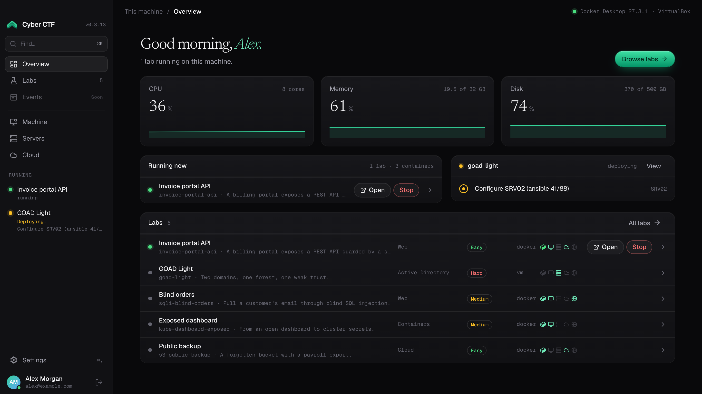

# Cyber CTF

The desktop launcher for [Cyber CTF](https://www.cyberctf.org) labs: hands-on, deliberately
vulnerable environments for learning offensive and defensive security. It runs each lab, with an
attack box to work from, on your own computer (Docker or virtual machines), on your own Proxmox or
ESXi server, or in your own cloud account (AWS, Azure, Google Cloud, DigitalOcean, Linode, Oracle
Cloud), and installs and checks the tools each of them needs.

It is for learners, for the trainers and teams who run Cyber CTF labs, and for the IT teams who
deploy it: the [administrator guide](docs/admin-guide.md) has what a security review and a managed
deployment need.



## Install

Every release is on [GitHub Releases](https://github.com/Cyber-Courses/Cyber-CTF-Launcher/releases),
with `SHA256SUMS` and a build provenance attestation for each file
([verify a download](docs/admin-guide.md#verify-a-download)).

### macOS (Apple silicon and Intel)

With [Homebrew](https://brew.sh):

```bash
brew tap Cyber-Courses/homebrew-tap
brew trust --tap cyber-courses/tap
brew install --cask cyberctf
```

Or download `Cyber.CTF_<version>_universal.dmg` and drag **Cyber CTF** to Applications.

### Windows (x64 and Arm64)

- **[Microsoft Store](https://apps.microsoft.com/detail/9P9L4WZ0N8ZJ)**, or
  `winget install --id 9P9L4WZ0N8ZJ --source msstore`.
- **Installer** for your account, no administrator rights: `Cyber.CTF_<version>_x64-setup.exe`
  (`_arm64-setup.exe` on Arm). Silent: `/S`.
- **MSI** for all users, for Intune, Configuration Manager or Group Policy (x64):
  `Cyber.CTF_<version>_x64_en-US.msi`. Silent: `msiexec /i <file> /qn`.

### Linux (x64 and arm64)

The apt repository (Debian, Ubuntu and derivatives), signed with the key
`B4B6 770F 5BED 6F3E 91BA C67E EB61 45F4 8E6D 7C1C`:

```bash
sudo curl -fsSL https://cyber-courses.github.io/apt/cyberctf-apt.asc -o /usr/share/keyrings/cyberctf.asc
echo "deb [signed-by=/usr/share/keyrings/cyberctf.asc] https://cyber-courses.github.io/apt stable main" \
  | sudo tee /etc/apt/sources.list.d/cyberctf.list
sudo apt update && sudo apt install cyber-ctf
```

Or download the `.deb` (`_amd64.deb`, `_arm64.deb`) or the `.AppImage` (`_amd64`, `_aarch64`).

### Updates

Installs from GitHub update themselves: the launcher checks for a new version when it starts and
installs it when you accept (only a package signed with the launcher's update key). Homebrew,
apt and the Store update through their own channel.

## System requirements

| Platform | Versions                                                               | Architectures        |
| -------- | ---------------------------------------------------------------------- | -------------------- |
| Windows  | 10 (version 2004 or later) and 11, with the WebView2 Runtime           | x64, Arm64           |
| macOS    | a release Apple still updates                                          | Apple silicon, Intel |
| Linux    | glibc 2.35 or later (Ubuntu 22.04, Debian 12 and later), WebKitGTK 4.1 | x64, arm64           |

What labs need, on the computer that runs them:

- **Memory**: 16 GB is comfortable; with 8–16 GB container labs run well and large VM labs may be
  slow; under 8 GB labs struggle.
- **Disk**: the attack box image takes about 14 GB once unpacked, and the Kali attack VM of a VM lab
  a disk of up to 40 GB; each lab's own images or VMs come on top.
- **Container labs**: a Docker-compatible engine (Docker Desktop, Docker Engine, OrbStack, Colima…)
  with Docker Compose. On Windows, Docker Desktop needs WSL 2.
- **VM labs**: hardware virtualization (Intel VT-x or AMD-V) turned on, a hypervisor (VirtualBox,
  VMware, Hyper-V, Parallels, libvirt, QEMU or UTM) and Vagrant.
- **Server and cloud labs**: Terraform, and for a cloud its own CLI; see
  [running labs](docs/running-labs.md#accounts-and-servers) for what a Proxmox or ESXi server needs.
- **Network**: Cyber CTF's online services for signing in, the catalogue and starting labs. The
  launcher can't run air-gapped ([network endpoints](docs/admin-guide.md#network)).

The launcher's first-run setup and its **Machine** page check all of this and install what is
missing.

## Quickstart

1. Open **Cyber CTF** and **Sign in** with your Cyber CTF account (in your browser).
2. Follow the setup: it installs a container engine and the attack box, and tests them.
3. Open **Labs**, pick a lab, select **Start lab**, and choose **This machine**.
4. When it is up, **Open attacker shell** and start hacking.
5. **Stop & remove** when you're done.

[Getting started](docs/getting-started.md) walks through it in detail;
[troubleshooting](docs/troubleshooting.md) helps when something goes wrong.

## Documentation

- [Getting started](docs/getting-started.md) and [troubleshooting](docs/troubleshooting.md)
- [Administrator guide](docs/admin-guide.md): silent install, network endpoints and ports, proxy
  and certificates, files and data, machine changes, privacy, uninstall; and the
  [policy reference](docs/reference/policy.md)
- [All the docs](docs/README.md), by what you came to do

## Signed releases

- **macOS**: the app is signed with a Developer ID and notarized by Apple.
- **Windows**: the installers and the app are Authenticode-signed from the release after 1.8.9;
  the release workflow refuses to publish a build it couldn't sign. Up to 1.8.9 they were not
  signed. The Microsoft Store package is signed by Microsoft.
- **Updates**: the in-app updater installs only packages signed with the launcher's own key.
- **Linux**: the apt repository is signed; each release has `SHA256SUMS`, build provenance
  attestations and SBOMs.

## Support and security

- Questions and bugs: [SUPPORT.md](SUPPORT.md). Settings > About has the diagnostics and logs to
  attach.
- Security vulnerabilities: report them privately, as [SECURITY.md](SECURITY.md) says. Only the
  latest release gets fixes ([versioning and support policy](docs/reference/versioning.md)).

## Contributing

Contributions are welcome: [CONTRIBUTING.md](CONTRIBUTING.md) has the setup, the tests and the
gates, and [docs/architecture.md](docs/architecture.md) maps the code. Please follow the
[code of conduct](CODE_OF_CONDUCT.md).

## Licence

Licensed under the [Apache License 2.0](LICENSE); see [NOTICE](NOTICE). Each release lists the
third-party software it includes and their licences in `THIRD_PARTY_NOTICES`.
